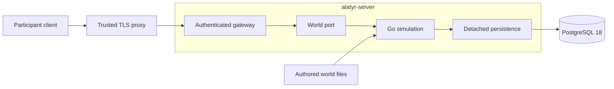

<div align="center">

<a href="https://l2go.github.io/alatyr/" title="Open the Alatyr project site"></a>

<br>

[](https://l2go.github.io/alatyr/)
[](https://github.com/l2go/alatyr/actions/workflows/build.yml)
[](https://github.com/l2go/alatyr/releases)
[](https://scorecard.dev/viewer/?uri=github.com/l2go/alatyr)
[](#origin-trademarks-and-license)

### An authored world · A Go server · PostgreSQL

**[Project site](https://l2go.github.io/alatyr/)** · [Start](#start) · [Architecture](#architecture) · [Deploy guide](deploy/README.md) · [Security](SECURITY.md)

</div>

Alatyr runs an authored online world through a bounded participant protocol.
The Go server owns the simulation, participant gateway and PostgreSQL persistence.
It ships Okolitsa: a village and hunting meadow on the island of Buyan.

## Start

Follow the [deployment guide](deploy/README.md) to configure a trusted proxy,
bind participant tokens to existing characters, and import the operator's
character snapshots. Then start the prepared stack:

```sh
cd deploy
docker compose up -d --wait
```

The image is `ghcr.io/l2go/alatyr`, for `linux/amd64` and `linux/arm64`.
A TLS proxy authenticates users and forwards the participant WebSocket endpoint.
There is no registration service; the operator owns the participant registry.
Each deployment starts with a fresh dedicated database. Existing data from other
server implementations is not imported.

## Architecture



The [Go components](docs/engine-go/README.md) keep protocol, transport, world
mechanics and persistence separate. The reusable module depends only on the
Apache-2.0 protocol module. Database dependencies belong to the nested server
application. The boundary checker enforces package directions and dependency pins.

Learning stores skills and the absolute SP balance in one transaction. Shutdown
joins participant operations before saving final world checkpoints, including
when the world stops itself. The container runs as user `10001` with a read-only
root, dropped capabilities and explicit memory limits.

## Verification and releases

Go checks cover unit tests, races, module boundaries, formatting, static analysis
and vulnerabilities. PostgreSQL tests exercise rollback, ownership, fresh-schema
admission and participant restart. Native image checks exercise readiness,
authenticated entry, live shutdown saves, restart and backup restore on both
platforms. The image world must match the authored repository bytes.

Main publishes signed, attested `edge` and `sha-<commit>` images only after its
gates pass. A release promotes that verified digest with maintainer approval;
it does not rebuild it. Release bundles contain the pinned Compose stack and
operator configuration examples. A release number is chosen separately.

| Channel | Image |
|---|---|
| Main | `ghcr.io/l2go/alatyr:edge` and `ghcr.io/l2go/alatyr:sha-<commit>` |
| Promoted release | `ghcr.io/l2go/alatyr:<version>` |

## Origin, trademarks, and license

The repository's history starts with the L2J community server in 2006 and the
archived [l2jfree/l2jfree-ct2.3](https://github.com/l2jfree/l2jfree-ct2.3), a
descendant of [savormix/l2jfree-genesis](https://github.com/savormix/l2jfree-genesis).
The current server, protocol and original world are the maintained product.
Historical releases and their engineering notes remain available as history.

The project distributes no game client, client files or NCSOFT software.
Lineage II and NCSOFT are trademarks of NCSOFT Corporation. This independent
project is not affiliated with or endorsed by NCSOFT.

| Path | License |
|---|---|
| `deploy/`, `tools/ci/`, other paths outside the entries below | [GPL-3.0-or-later](LICENSE) |
| `engine/go/protocol/` | [Apache-2.0](engine/go/protocol/LICENSE) |
| `engine/go/`, except protocol | [AGPL-3.0-or-later](engine/go/LICENSE), including the server application |
| `tools/world/` | [AGPL-3.0-or-later](tools/world/LICENSE) |
| `world/` | [CC BY-SA 4.0](world/LICENSE); format definitions under `world/src/data/templates/` retain GPL-3.0-or-later |
