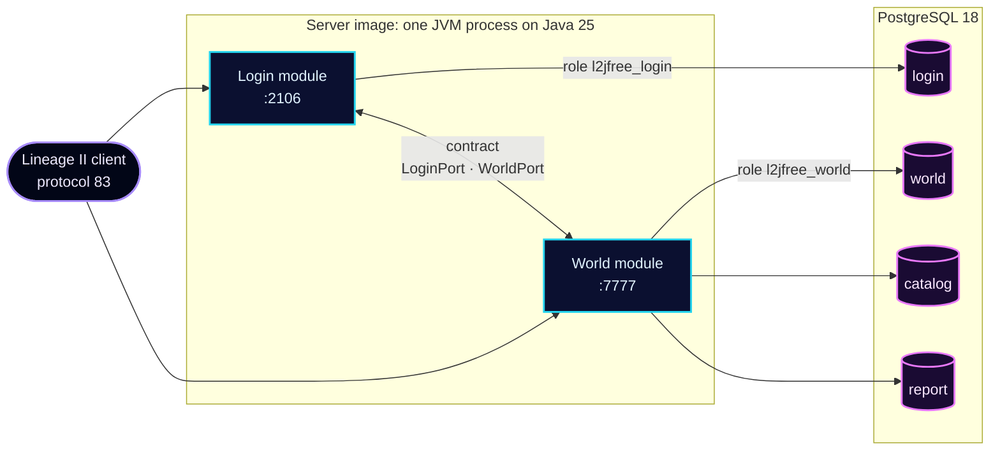

<div align="center">


<br>

[](https://github.com/l2go/l2jfree/actions/workflows/build.yml)
[](https://github.com/l2go/l2jfree/releases)
[](LICENSE)
<br>


### One process · Two ports · One command

[Launch](#launch) · [Architecture](#architecture) · [What ships](#what-ships) · [Releases](#releases) · [Deploy guide](deploy/README.md)

</div>

## Launch

From a checkout, with Docker:

```sh
docker compose -f deploy/compose.yaml up -d --wait
```

When the command returns, login answers on **2106** and the world on **7777**. The first login creates the account.

> [!TIP]
> Players on other machines need `L2JFREE_EXTERNAL_HOST` set to the address of the host. Settings, backup, and restore are in the [deploy guide](deploy/README.md). A release bundle has its own [guide](deploy/release/README.md).

## Architecture



The two modules meet only through the contract, and the build fails if either reaches into the other. Each module connects with its own database role and reaches only the schemas it owns. At start, the world brings `catalog` up to the game content of the image.

## What ships

<table>
<tr>
<td width="33%" valign="top">

**⚡ One process**

Login and world in one JVM, joined by a typed contract instead of a socket protocol.

</td>
<td width="33%" valign="top">

**🐘 PostgreSQL 18**

Migrations run at start. CI prepares every SQL statement of the server against the real schema.

</td>
<td width="33%" valign="top">

**🔏 Signed image**

A cosign signature, an SBOM, and build provenance on every published image.

</td>
</tr>
<tr>
<td width="33%" valign="top">

**🧪 Proved on every merge**

The image starts, 24 clients play whole sessions, the server restarts, and a backup is restored into a clean stack.

</td>
<td width="33%" valign="top">

**🛰️ Native network core**

Netty on epoll by default, with io_uring on request.

</td>
<td width="33%" valign="top">

**🛡️ Locked down**

User `10001`, a read-only root, no added capabilities, and a 4 GB memory limit.

</td>
</tr>
</table>

## Releases

| Channel | Image | Published |
|---|---|---|
| Release | `ghcr.io/l2go/l2jfree:<version>` | With a compose bundle on the [releases page](https://github.com/l2go/l2jfree/releases) |
| Edge | `ghcr.io/l2go/l2jfree:edge` | On every merge to `main` |

> [!IMPORTANT]
> No version is supported. The 2.x line ended with `v2.5.0`, and a 2.x database cannot be migrated. Report a vulnerability through the [security policy](SECURITY.md).

## Origin and license

Forked from [l2jfree/l2jfree-ct2.3](https://github.com/l2jfree/l2jfree-ct2.3), which descends from [savormix/l2jfree-genesis](https://github.com/savormix/l2jfree-genesis). The [original README](UPSTREAM_README.md) is kept unchanged. This project provides the server source only, with no client and no hosted server. The inherited datapack text was not audited. Lineage II is a trademark of its owner. The code is under [GPLv3](LICENSE).

<div align="center">
<sub>Built, started, and checked by GitHub Actions on every merge.</sub>
</div>
