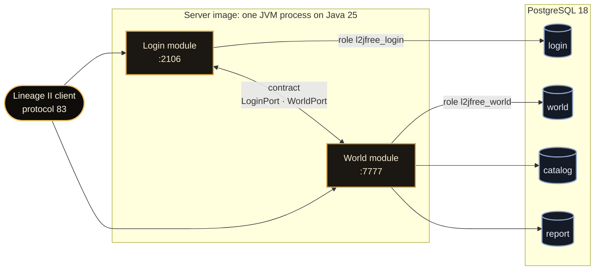

<div align="center">


<br>

[](https://github.com/l2go/l2jfree/actions/workflows/build.yml)
[](https://github.com/l2go/l2jfree/releases)
[](https://scorecard.dev/viewer/?uri=github.com/l2go/l2jfree)
[](LICENSE)

### One process · Two ports · One command

[Start](#start) · [Architecture](#architecture) · [What ships](#what-ships) · [Releases](#releases) · [Deploy guide](deploy/README.md) · [Security](SECURITY.md)

</div>

L2JFree is a Lineage II server for Gracia Final, protocol 83. Login and world run in one Java 25 process on PostgreSQL 18, deployed with Docker Compose.

## Start

From a checkout:

```sh
cd deploy
docker compose up -d --wait
```

The first start runs the `edge` image and takes a few minutes. When the command returns, login answers on port **2106** and the world on **7777**. The first login creates the account.

## Architecture



The two modules talk only through a typed contract; the build fails if one depends on the other. Each module has its own database role and reaches only its own schemas. At start, the world updates `catalog` from the image.

## What ships

<table>
<tr>
<td width="33%" valign="top">

**🧪 Checked on every merge**

The image starts, and 24 clients log in, create a character, enter the world, and log out. After a restart and after a restored backup, the account finds its characters again. Every SQL statement of the server is prepared against the real schema.

</td>
<td width="33%" valign="top">

**🔏 Signed**

Every published image carries a cosign signature, an SBOM, and build provenance. A release archive carries its own signature.

</td>
<td width="33%" valign="top">

**🛡️ Locked down**

User `10001`, a read-only root, no added capabilities, and a 4 GB memory limit. Netty runs on epoll.

</td>
</tr>
</table>

## Releases

| Channel | Image | Published |
|---|---|---|
| Release | `ghcr.io/l2go/l2jfree:<version>` | With a compose bundle on the [releases page](https://github.com/l2go/l2jfree/releases) |
| Edge | `ghcr.io/l2go/l2jfree:edge` | On every merge to `main` |

## Origin and license

Forked from [l2jfree/l2jfree-ct2.3](https://github.com/l2jfree/l2jfree-ct2.3), a descendant of [savormix/l2jfree-genesis](https://github.com/savormix/l2jfree-genesis); its [README](UPSTREAM_README.md) is kept unchanged. This repository holds the server only: no client, no hosted server. The datapack came with the fork and was not reviewed. Lineage II is a trademark of its owner. The code is under [GPLv3](LICENSE).
