<div align="center">

<a href="https://l2go.github.io/alatyr/" title="Open the Alatyr project site"></a>

<br>

[](https://l2go.github.io/alatyr/)
[](https://github.com/l2go/alatyr/actions/workflows/build.yml)
[](https://github.com/l2go/alatyr/releases)
[](https://scorecard.dev/viewer/?uri=github.com/l2go/alatyr)
[](#origin-trademarks-and-license)

### An authored world · A Go server · PostgreSQL

**[Project site](https://l2go.github.io/alatyr/)** · [Start](#start) · [Engineering](#engineering) · [Architecture](#architecture) · [Releases](#releases) · [Deploy guide](deploy/README.md) · [Security](SECURITY.md)

</div>

Alatyr runs an authored online world through a bounded participant protocol.
The Go server owns the simulation, participant gateway and PostgreSQL persistence.
It ships Okolitsa: a village and hunting meadow on the island of Buyan.

## Start

Follow the [deployment guide](deploy/README.md) to configure a trusted proxy,
bind participant tokens to existing characters, and import the operator's
character snapshots. Then start the prepared stack:

```sh
cd deploy
docker compose up -d --wait
```

The image is `ghcr.io/l2go/alatyr`, for `linux/amd64` and `linux/arm64`.
A TLS proxy authenticates users and forwards the participant WebSocket endpoint.
There is no registration service; the operator owns the participant registry.
Each deployment starts with a fresh dedicated database. Existing data from other
server implementations is not imported.

## Engineering

<table>
<tr>
<td width="33%" valign="top">

**🧱 Boundaries the build enforces**

Protocol, transport, world mechanics and persistence are separate packages. A boundary checker reads every Go file, tests and inactive build tags included, and fails the build on any import outside its [policy](tools/ci/engine-go-policy.json). The protocol module is Apache-2.0 and depends only on the standard library.

</td>
<td width="33%" valign="top">

**✅ Done is proven, never assumed**

A participant sees Done only after a live world fact with its own cause arrives in time. Receipts, snapshots and late events cannot claim success; anything unproven ends as Unknown. The [contract](engine/go/gateway/backend/README.md) is checked against the real world.

</td>
<td width="33%" valign="top">

**🎲 Replayed byte for byte**

Byte programs drive the real gateway and Go world in virtual time, through reconnects, deaths and lost evidence. Each input runs twice and every socket's transcript must match byte for byte, while [oracles](engine/go/worldtest/README.md) check outcomes, economy and saved characters. Native fuzzing runs on `main`.

</td>
</tr>
<tr>
<td width="33%" valign="top">

**🗄️ One writer, forward-only schema**

The server holds a PostgreSQL advisory lease for its whole life and refuses a database with foreign objects or another migration history. Learning saves skills and SP in one transaction, and shutdown joins participant work before the final checkpoints.

</td>
<td width="33%" valign="top">

**🧪 Every merge is a release rehearsal**

On both native platforms the image passes readiness, authenticated participant entry, a save on live shutdown, a restart, and a backup restore into a clean stack. Its world must match the repository bytes.

</td>
<td width="33%" valign="top">

**🛡️ Signed, promoted, hardened**

Each `main` image is signed with cosign and carries build provenance; a release promotes that digest and never rebuilds it. Actions are pinned by commit, and Trivy blocks a fixable critical or high finding. The server runs as user `10001` on a read-only root, with no capabilities and a 256 MiB memory limit.

</td>
</tr>
</table>

## Architecture

<a href="https://l2go.github.io/alatyr/#architecture" title="Open the architecture on the project site"></a>

The [Go components](docs/engine-go/README.md) keep protocol, transport, world
mechanics and persistence separate. The reusable module depends only on the
Apache-2.0 protocol module. Database dependencies belong to the nested server
application. The boundary checker enforces package directions and dependency pins.

## Releases

Go checks cover unit tests, races, module boundaries, formatting, static analysis
and vulnerabilities. PostgreSQL tests exercise rollback, ownership, fresh-schema
admission and participant restart.

Main publishes signed, attested `edge` and `sha-<commit>` images only after its
gates pass. A release promotes that verified digest with maintainer approval;
it does not rebuild it. Release bundles contain the pinned Compose stack and
operator configuration examples. A release number is chosen separately.

| Channel | Image |
|---|---|
| Main | `ghcr.io/l2go/alatyr:edge` and `ghcr.io/l2go/alatyr:sha-<commit>` |
| Promoted release | `ghcr.io/l2go/alatyr:<version>` |

## Origin, trademarks, and license

The repository's history starts with the L2J community server in 2006 and the
archived [l2jfree/l2jfree-ct2.3](https://github.com/l2jfree/l2jfree-ct2.3), a
descendant of [savormix/l2jfree-genesis](https://github.com/savormix/l2jfree-genesis).
The current server, protocol and original world are the maintained product.
Historical releases and their engineering notes remain available as history.

The project distributes no game client, client files or NCSOFT software.
Lineage II and NCSOFT are trademarks of NCSOFT Corporation. This independent
project is not affiliated with or endorsed by NCSOFT.

| Path | License |
|---|---|
| `deploy/`, `tools/ci/`, other paths outside the entries below | [GPL-3.0-or-later](LICENSE) |
| `engine/go/protocol/` | [Apache-2.0](engine/go/protocol/LICENSE) |
| `engine/go/`, except protocol | [AGPL-3.0-or-later](engine/go/LICENSE), including the server application |
| `tools/world/` | [AGPL-3.0-or-later](tools/world/LICENSE) |
| `world/` | [CC BY-SA 4.0](world/LICENSE); format definitions under `world/src/data/templates/` retain GPL-3.0-or-later |
