<div align="center">

<a href="https://l2go.github.io/alatyr/" title="Open the Alatyr project site"></a>

<br>

[](https://l2go.github.io/alatyr/)
[](https://github.com/l2go/alatyr/actions/workflows/build.yml)
[](https://github.com/l2go/alatyr/releases)
[](https://scorecard.dev/viewer/?uri=github.com/l2go/alatyr)
[](#origin-trademarks-and-license)

### One process · Two ports · One command

**[Project site](https://l2go.github.io/alatyr/)** · [Start](#start) · [Engineering](#engineering) · [Architecture](#architecture) · [Releases](#releases) · [Deploy guide](deploy/README.md) · [Security](SECURITY.md)

</div>

L2JFree is a Lineage II server for Gracia Final, protocol 83. Login and world run in one Java 25 process on PostgreSQL 18, deployed with Docker Compose.

## Start

From a checkout:

```sh
cd deploy
docker compose up -d --wait
```

The image supports `linux/amd64` and `linux/arm64`.

The first start runs the `edge` image and takes a few minutes. When the command returns, login answers on port **2106** and the world on **7777**. The first login creates the account.

Out of the box the server runs **Okolitsa**, a small original world on the island of Buyan: a village with a trainer and a merchant, and a meadow with beasts for the first levels. To run another world, see [Run another world](deploy/README.md#run-another-world).

## Engineering

<table>
<tr>
<td width="33%" valign="top">

**🧱 One process, hard boundaries**

Login and world share a JVM, not code. They meet only through a typed contract, and architecture rules fail the build on any other dependency. Each module has its own database role, and the pipeline checks what each role can reach.

</td>
<td width="33%" valign="top">

**🗄️ SQL checked against the schema**

The SQL strings of the compiled world classes are prepared against the migrated PostgreSQL schema, and every JDBC type is compared with its column. A ratchet keeps direct database access from spreading.

</td>
<td width="33%" valign="top">

**🧪 Every merge is a release rehearsal**

The image starts on both platforms, and 24 clients log in, create a character, enter the world, and log out. The server restarts, a backup is restored into a clean stack, and, when the previous image can be pulled, the running stack is upgraded in place from it. The saved characters remain available after each restart, restore, and upgrade.

</td>
</tr>
<tr>
<td width="33%" valign="top">

**🚀 Releases promote, never rebuild**

A release retags the image digest that `main` built and tested, after the maintainer approves. The image carries a cosign signature and build provenance; the compose archive carries its own signature.

</td>
<td width="33%" valign="top">

**🛡️ Hardened supply chain and runtime**

Actions are pinned by commit, and Trivy blocks a release on a critical or high finding that has a fix. The container runs as user `10001` with a read-only root, no capabilities, and a 4 GB memory limit.

</td>
<td width="33%" valign="top">

**🔭 Diagnosable in production**

Java Flight Recorder keeps the last 12 hours. PostgreSQL counts every statement and logs the plan of any that runs over 500 ms. A health endpoint gates readiness, and a stop refuses new connections first.

</td>
</tr>
</table>

The decisions in code: the [architecture rules](engine/java/platform/src/test/java/com/l2jfree/platform/ArchitectureTest.java) between the modules, a player save in [one transaction](https://github.com/l2go/alatyr/pull/162), and a weight-check bypass closed by [a wider type](https://github.com/l2go/alatyr/pull/193). The [engineering notes](https://l2go.github.io/alatyr/#notes) on the project site take one decision at a time.

## Architecture

The [Go components](docs/engine-go/README.md) establish the modules for a future gateway and world adapter.


Login owns the `login` schema; world owns `world`, `catalog`, and `report`. At start, the world updates `catalog` from the world directory: the one in the image, or your own.

## Releases

| Channel | Image | Published |
|---|---|---|
| Release | `ghcr.io/l2go/l2jfree:<version>` | With a compose bundle on the [releases page](https://github.com/l2go/alatyr/releases) |
| Edge | `ghcr.io/l2go/l2jfree:edge` | On every merge to `main` |

## Origin, trademarks, and license

L2JFree is an open-source Lineage II server from the L2J community; its history in this repository starts in 2006. This repository revives [l2jfree/l2jfree-ct2.3](https://github.com/l2jfree/l2jfree-ct2.3), archived since 2016, a descendant of [savormix/l2jfree-genesis](https://github.com/savormix/l2jfree-genesis). The work here is modernization: the code moved to Java 25 and PostgreSQL 18, login and world joined in one process, each player save became a single transaction, and economy exploits and concurrency races were fixed, with regression checks in CI.

Since 3.2 the repository, the image, and the release archive carry no data inherited from the fork. The world they ship, Okolitsa, is original content. The project does not modify, patch, or distribute the game client.

Lineage II and NCSOFT are trademarks or registered trademarks of NCSOFT Corporation. L2JFree is an independent, non-commercial project, not affiliated with, endorsed, or sponsored by NCSOFT. The names say only which game client the server works with. The repository holds no game client, no client files, and no NCSOFT software, and no server is hosted.

| Path | License |
|---|---|
| `engine/java/`, `deploy/`, `tools/ci/`, everything not listed below | [GPL-3.0-or-later](LICENSE) |
| `engine/go/protocol/` | [Apache-2.0](engine/go/protocol/LICENSE) |
| `engine/go/gateway/`, `engine/go/bridge/`, `engine/go/world/` | [AGPL-3.0-or-later](engine/go/gateway/LICENSE); each module carries its own license file |
| `tools/world/` | [AGPL-3.0-or-later](tools/world/LICENSE) |
| `world/` | [CC BY-SA 4.0](world/LICENSE); its format definitions in `world/src/data/templates/` stay under GPL-3.0-or-later |
